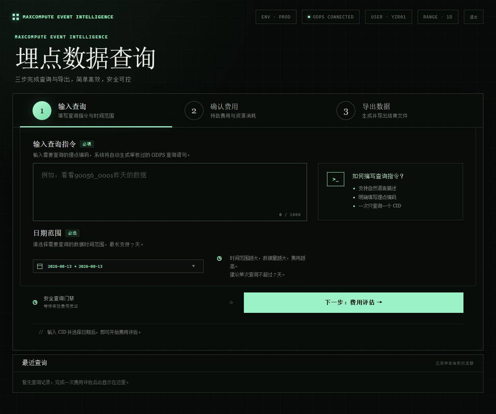

# 埋点数据自助拉取工具

这是一个面向数据分析、产品和运营同事的内部工具骨架：用户从企业微信或网页提交自然语言问题，服务提取事件编码，查询 MaxCompute/ODPS 最近 7 个自然日的数据，生成包含原始明细和 `聚合统计` Sheet 的 Excel 文件，并记录请求与下载审计。



当前发布版本：`v0.1.4`。

v0.1.4：客户端新查询默认选择 value1～value25，并在明细 SQL 与 XLSX 中返回这些字段；取消某项即从明细返回字段中移除。显式保存的旧筛选字段列表（包括空列表）照原样恢复，WEB 查询不应用客户端 value 字段。

v0.1.3：PV/UV 图表在柱子下方标事件名，统计面板常驻最近查询下方；版本筛选增加默认“大于等于”，排除模式可增减独立版本输入框；最近查询显示全部客户端筛选摘要。多事件 SQL 与完整聚合已补回归测试；未返回事件的提示明确说明日期和其他筛选条件可能影响结果。

v0.1.1：事件与日期在桌面端严格按 65:35 分栏；多个 valueX 的条件组固定以 OR 连接，移除字段间关系选择框，旧历史中的 AND 自动归一化为 OR，单个 valueX 内部的与/或逻辑不变；费用回执保持原外框大小和位置，仅改为三栏信息布局，窄屏时自动换行。

v0.1.1 微调：桌面端事件/日期分栏改为 55:45；多事件校验会标红并聚焦实际未填写或无效的那一行，编辑后清除错误状态。

v0.1.0 页面优化：费用评估回执移到“重新评估”和“查询”操作区之间，仅显示评估通过、查询分区和预估费用；评估后输入表单不再被右侧回执挤窄。日期范围调整为原并排宽度约 40%，输入查询事件相应扩展；窄屏仍自动纵向排列。费用估算、查询和账户数据逻辑未更改。

v0.0.9 页面优化：移除查询指令帮助卡，事件与日期并排，系统／版本／新旧用户／选择值筛选位于其下；valueX 默认不选择，展开后每行五项且仅显示两行可滚动，悬停或键盘聚焦会出现条件筛选提示；最近查询移至 PV/UV 统计下方。费用评估和查询逻辑保持不变。

v0.0.8 微调：系统选项 ios／android／harmonyos 常显；客户端事件标题改为“输入查询事件”，只显示分段 CID 输入行，左右输入框宽度约 7:3；WEB 端继续使用 eventid 输入，改为单行。客户端 CID 现支持英文字母、数字及下划线，例如 `UID_WITHOUT_TOKEN`；纯数字 CID 沿用 5～7 位规则，完整编码最多 32 位。含下划线的 CID 使用字面包含匹配，避免 SQL LIKE 将下划线当作通配符。客户端固定产品范围包含鸿蒙产品 `65462`；旧筛选记录中的 `harmony` 会转换为 `harmonyos`。估价与查询使用同一规则；未更改账号或数据库结构。

v0.0.7 新增：

- 客户端版本筛选可选“大于等于／大于／排除／枚举”，默认“大于等于”。前两种仅接受单个纯数字版本（最多四段），按各段从左到右比较；例如 17.1.0 大于 16.3.1。排除可增减独立版本输入框，枚举可输入多个版本并以空格或逗号分隔；留空均不加版本条件。
- value 字段自定义筛选默认一条；新增条件后，每两个相邻条件可独立选择“与／或”，按页面顺序从左到右加括号执行。
- 系统默认勾选 ios、android、harmonyos。客户端事件改为 CID 与可选后缀的独立输入框，后缀 1／01／001／0001 统一为 0001（2、3 同理）；可增加至 50 行。无后缀为包含匹配，有后缀为完整事件匹配，多行始终用 OR。
- 费用评估和真实查询共用上述 SQL 计划，改条件后旧估价失效。WEB 日志输入保持原方式。旧版费用凭证需重新评估。此次无需更改 `.env`、账号或数据库结构。

v0.0.6 新增：

- 客户端 value1～value25 的漏斗筛选，仅选中返回字段可设置。字段内默认两条条件，可增减（1～20条），支持与/或；字段组之间另有与/或选择和摘要。取消字段选择会清除其筛选。
- 六种数值比较使用 BIGINT，目标值必须为有符号64位整数；源数据非整数或溢出时不匹配。六种文字比较按原文字面匹配，`%`、`_` 不作为通配符。NULL 不匹配数值/非空文字条件。
- 新/旧用户筛选（is_new=1/0），默认全选不加条件；客户端明细包含 is_new，源表必须有此列。WEB 不应用客户端筛选。
- v0.0.6 时两端支持空格分隔多事件（最多50个），客户端保留包含匹配，WEB 精确匹配；v0.0.7 的客户端输入与匹配规则见上文。完整结果按日期＋实际返回事件聚合；柱图可选事件、切换PV/UV。未匹配输入事件会明显提示，判定不受明细截断影响。UV合计不是跨日期或跨事件去重人数。
- XLSX 聚合统计在前，包含实际事件编码、条件和缺失事件说明。历史查询保存所有新条件；修改后必须重新估价。

升级时先停止 API/Worker、备份实际数据库，再启动 API 执行增量迁移（任务上下文新增 event_codes_json，聚合记录新增 event_code），最后启动同版本 Worker。旧账号、密码哈希、使用统计与文件不删除；旧任务读取有兼容回退。v0.0.5 费用凭证需重新评估。不需要修改 `.env` 或重新创建用户。

v0.0.5：客户端新增 sys 多选、空格分隔的 ver 精确匹配，以及 value1～value25 返回字段选择（默认 value1/2/3）。WEB 不应用这些客户端条件。所有筛选条件随任务和历史保存，并绑定费用凭证；改变条件需要重新评估。当前 `sys` 值使用 ios/android/harmonyos，客户端表需具有选中的 value 列。

“查询”按钮沿用先估价再执行的流程，完成后自动下载 XLSX。PV/UV 图表右上角切换指标，柱顶显示完整数值，切换不重新查库。XLSX 首个 Sheet 为聚合统计，第二个为原始数据。明细 SQL 最多 LIMIT 200000（配置更低上限时取更低值），超过上限正常导出并提示截取；全量 PV/UV 不受此限制，无排序的明细返回顺序不保证。估价涵盖有限明细 SQL 和全量聚合 SQL，不承诺 LIMIT 等比例降低费用。

v0.0.5 升级须先停止 API/Worker 并备份实际数据库，再启动 API 自动增加 filters_json/export_limit 字段，最后启动 Worker。仅增加任务上下文字段，不删除账号、密码和历史统计。v0.0.4 的费用凭证失效，需要重新评估。

v0.0.4 新增 WEB 日志：在输入框上方选择“WEB端”，输入8位 eventid（例如70081134）。复用现有 ODPS 项目、账号及日期配置；该账号需有 `yy_websdkprotocol_original` 读取权限，dt 分区格式需与现有日期配置一致。一次查询一个事件，默认昨天，最多7天，不含今天。

客户端 SQL 保持原模板，WEB 模板位于 `sql/web_event_detail.sql`。导出包含“原始数据”和“聚合统计”，WEB 明细为 uid/time/act_type/eventid/dt，每日统计按 dt、eventid 计算 COUNT(1) 和 COUNT(DISTINCT uid)。UV 每日合计不是区间去重人数。

两端费用评估均分别调用两条实际执行 SQL 的 execute_sql_cost，扫描量合计后按配置单价折算；复杂度展示两条中的最大值。金额是内部估算，不是阿里云实际账单。估价凭证绑定端类型、账号、事件和日期，切换类型或更新旧版凭证后需重新评估。

升级前停止 API/Worker，备份 `.env` 和数据库；安装依赖后启动 API，会自动给旧任务上下文增加 log_type 字段并默认 client，保留账号、密码哈希和历史统计，再启动 Worker。两端共用原每日预算。

## 当前状态

已提供可配置的 V1 服务结构、事件编码解析、SQL 安全渲染、后台任务接口、审计模型、ODPS 网关、XlsxWriter 流式导出、Docker 部署文件和单元测试。XLSX 构建为纯 Python 实现，不依赖 Node.js、Codex 或私有 npm 包。它**不会**在没有账号、表名、字段和企业微信应用配置时访问任何生产数据。

在接入前，请先确认企业微信入口：普通“群机器人 Webhook”适合向群里发送消息，不能作为用户输入后由服务接收并处理的入口。此需求应使用企业微信的“智能机器人 API 模式”或自建应用的消息回调；详见 [docs/architecture/v1-design.md](docs/architecture/v1-design.md)。

## 本地启动

1. 复制 `.env.example` 为 `.env`，填写 **测试环境** 的 ODPS 参数和管理员令牌；生产环境请改用 RAM 最小权限凭证或临时 STS 凭证。
2. 将实际、已审核的查询 SQL 改写到 `sql/event_detail.sql`。该 SQL 必须返回 `event_date` 和 `user_id` 两个别名列。
3. 使用 Docker Compose 启动 API、Worker、PostgreSQL 和 Redis：

   ```bash
   docker compose up --build
   ```

4. 打开 `http://localhost:8000/` 提交问题。开发环境 API 文档在 `http://localhost:8000/docs`。

## 登录、查询窗口与统计

- 网页必须先登录；会话保存在签名的 HttpOnly Cookie 中，密码只保存 scrypt 哈希。
- 默认查询昨天，用户可以选择最长 7 天的完整日期区间；今天及未来日期不可查询。费用凭证会绑定账号、CID 和分区，修改日期后必须重新评估。
- 超级管理员统计页地址为 `/admin/usage`，普通成员即使知道地址也会被服务端拒绝。统计项包括账号访问次数、停留时间、费用评估次数、导出次数、估算消耗金额、IP 和访问时间戳。
- 超级管理员可以设置全局单用户每日查询金额上限（0 表示不限制）；成员和超级管理员均在导出前由服务端校验当日余额。
- 查询成功后页面显示按 `dt` 聚合的 PV/UV 图表，并提供包含“原始数据”和“聚合统计”两个工作表的 XLSX 下载。

本地新增或重置普通成员账号：

```powershell
.\.venv\Scripts\python.exe .\scripts\manage_users.py upsert member01 --display-name "成员一"
```

命令会在终端中安全提示输入密码，不会把密码写入命令历史。查看或停用账号：

```powershell
.\.venv\Scripts\python.exe .\scripts\manage_users.py list
.\.venv\Scripts\python.exe .\scripts\manage_users.py deactivate member01
```

## V1 接口

- `POST /api/v1/query-requests`：接收网页或标准化企业微信入口转发的 `{ "question": "查询 10001_0001" }`。
- `GET /api/v1/jobs/{job_id}`：查看异步任务状态。
- `GET /api/v1/jobs/{job_id}/download`：下载结果并写入下载审计。
- `GET /api/v1/admin/stats`：管理员统计接口，需要 `X-Admin-Token`。

## 接入时需要提供的最小信息

不要把 AccessKey 贴到代码库或聊天记录。请通过受控密钥渠道配置：

1. ODPS Project、Endpoint、Tunnel Endpoint 和只读 RAM/STS 授权方式；
2. 固定数据表名、分区字段及格式、CID 字段、UV 去重字段；
3. 现有的、可运行的明细 SQL（需声明哪些字段可导出）；
4. 企业微信选择的接入模式以及测试应用的回调参数；
5. 最大允许导出行数、数据保留时长和有权限使用该工具的部门/人员范围。

## 验证

核心单元测试不需要 ODPS 或企业微信凭证：

```bash
pytest -q
```

关于 xlsx 的实际构建与视觉验证，见 [docs/runbook/development-and-deployment.md](docs/runbook/development-and-deployment.md)。
